# Especificação Técnica Detalhada (funcoes.md)

Este documento descreve detalhadamente a engenharia do software, especificando funções, classes, casos de uso, contratos de dados JSON, arquitetura em 4 camadas e interfaces de interação do sistema.

---

## 🎯 1. Metadados do Sistema & Plataforma de Destino

- **Dispositivos Alvo:** Smartphones e Tablets Android (arquiteturas ARM64-v8a e x86_64).
- **Versão Mínima do Android:** Android 8.0 (API 26) ou superior.
- **Versão Recomendada / Teste:** Android 11+ (API 30+) com suporte total ao isolamento de armazenamento (*Scoped Storage*).
- **Público-Alvo:** Jogadores de roguelikes tradicionais, RPGs táticos e entusiastas de modding sandbox.
- **Hospedagem & Infraestrutura de Rede:**
  - **100% Client-Side / Offline:** Toda a execução, persistência e simulação física rodam estritamente no processador do dispositivo móvel. Custo zero de servidor externo.
- **Stack Oficial:**
  - **Linguagem:** Java 17 LTS.
  - **Gerenciador de Dependências & Build:** Gradle com Kotlin DSL.
  - **Serializador JSON:** Biblioteca leve desacoplada (Google Gson ou Jackson Core) implementada atrás de interfaces de repositório.
  - **Backend de Janela e Gráficos:** LibGDX (módulo Android) ou Android SurfaceView nativo para renderização gráfica 2D em 60 FPS com baixo consumo energético.

---

## 🏛️ 2. Arquitetura em 4 Camadas Limpas (Mapeamento de Funções & Classes)

```mermaid
flowchart TD
    subgraph Camada_1_UI["Camada 1: Apresentação (UI)"]
        MapView["MapView (Renderizador de Tiles)"]
        InventoryGridWidget["InventoryGridWidget (Grade Tátil)"]
        AnatomyWidget["AnatomyWidget (Silhueta do Corpo)"]
        ContextMenuView["ContextMenuView (Menu Radial/Pop-up)"]
        HUDView["HUDView (Barras e Alertas)"]
    end

    subgraph Camada_2_Controllers["Camada 2: Controle & Estado"]
        GameLoopController["GameLoopController"]
        TurnManager["TurnManager (Pontos de Ação)"]
        InteractionController["InteractionController"]
        InventoryController["InventoryController"]
    end

    subgraph Camada_3_Domain["Camada 3: Domínio & Casos de Uso (Puro Java)"]
        UC_Range["CalcularRangeTesteUseCase"]
        UC_Pesos["CalcularDistribuicaoPesosUseCase"]
        UC_Sorteio["ExecutarSorteioPonderadoUseCase"]
        UC_Alvo["CalcularAlvoDificuldadeUseCase"]
        UC_Grau["ResolverGrauSucessoUseCase"]
        UC_Massa["CalcularMassaProceduralUseCase"]
        UC_Sobrecarga["CalcularSobrecargaUseCase"]
        UC_Anatomia["SortearMembroAtingidoUseCase"]
        UC_Dano["ProcessarDanoMembroUseCase"]
        UC_Reacao["ProcessarReacaoAmbientalUseCase"]
        UC_Metabolismo["AtualizarMetabolismoTurnoUseCase"]
    end

    subgraph Camada_4_Data["Camada 4: Dados & Repositórios"]
        ModLoader["CascadeModLoader"]
        MaterialRepo["JsonMaterialRepository"]
        DamageRepo["JsonDamageTypeRepository"]
        ItemRepo["JsonItemRepository"]
        AnatomyRepo["JsonAnatomyRepository"]
        ReactionRepo["JsonEnvironmentalReactionRepository"]
        SaveRepo["JsonSaveGameRepository"]
    end

    Camada_1_UI --> Camada_2_Controllers
    Camada_2_Controllers --> Camada_3_Domain
    Camada_3_Domain --> Camada_4_Data
```



---

## 🧠 3. Camada de Domínio: Especificação dos Casos de Uso (Use Cases)

Cada caso de uso reside em um arquivo individual dentro de `domain/usecases/`:

### 🎲 3.1. `CalcularRangeTesteUseCase`
- **Arquivo:** `CalcularRangeTesteUseCase.java`
- **Responsabilidade:** Determinar os limites numéricos mínimo e máximo do intervalo sorteável.
- **Entrada (DTO):** `AtributoTesteDTO` (valor do atributo base, multiplicador linear configurado em `world_rules.json`).
- **Saída:** `RangeTesteVO` (valor mínimo e valor máximo).
- **Lógica:**
  - $Minimo = Atributo$
  - $Maximo = Atributo \times Multiplicador$ (padrão: 10)
  - Validação *Fail-Fast*: se $Atributo < 1$, lança exceção imediata.

### 📊 3.2. `CalcularDistribuicaoPesosUseCase`
- **Arquivo:** `CalcularDistribuicaoPesosUseCase.java`
- **Responsabilidade:** Gerar a matriz de pesos probabilísticos sobre o intervalo sorteável.
- **Entrada (DTO):** `ConfiguracaoPesosDTO` (range base, nível da perícia de 0 a 70).
- **Saída:** `TabelaPesosVO` (array ou mapa com o peso atribuído a cada número do intervalo).
- **Lógica:**
  - **Se Nível == 0 (Inexperiente):** Gera Rampa de Decaimento. O elemento inicial recebe peso máximo (ex.: 100) e decai linearmente até o último elemento que recebe peso 1.
  - **Se Nível entre 1 e 70:** Aplica a equação do "Monte de Areia". O nível dita o percentil central do range e a altura do pico. A cada nível incrementado, o ponto focal desliza para a direita sem zerar os pesos anteriores.

### 🎯 3.3. `ExecutarSorteioPonderadoUseCase`
- **Arquivo:** `ExecutarSorteioPonderadoUseCase.java`
- **Responsabilidade:** Realizar a rolagem estocástica baseada nos pesos gerados.
- **Entrada:** `TabelaPesosVO`, gerador determinístico de números aleatórios (`IRandomProvider`).
- **Saída:** `int` (valor sorteado final).
- **Lógica:**
  - Calcula o pool total somando todos os pesos.
  - Sorteia um número pseudoaleatório entre $0$ e $PoolTotal$.
  - Itera sobre os elementos subtraindo o peso de cada um até que o acumulador atinja zero ou menos. O elemento onde parou é o resultado oficial da rolagem.

### 🛡️ 3.4. `CalcularAlvoDificuldadeUseCase`
- **Arquivo:** `CalcularAlvoDificuldadeUseCase.java`
- **Responsabilidade:** Determinar a Classe de Dificuldade (Alvo) dinâmica de uma interação no mundo.
- **Entrada (DTO):** `InteracaoAlvoDTO` (dureza do material da entidade alvo, nível do objeto alvo, modificador da ferramenta do jogador, bônus de força).
- **Saída:** `double` (valor alvo absoluto a ser confrontado).
- **Lógica:**
  - $Defesa = DurezaMaterial \times NivelAlvo$
  - $MultiplicadorFerramenta = ModificadorMaterial$ (lido de `materials.json` para o tipo de dano da ferramenta)
  - $Alvo = \frac{Defesa}{MultiplicadorFerramenta}$

### ⚖️ 3.5. `ResolverGrauSucessoUseCase`
- **Arquivo:** `ResolverGrauSucessoUseCase.java`
- **Responsabilidade:** Categorizar o desfecho da ação em um dos 5 graus de sucesso.
- **Entrada:** `double valorSorteado`, `double valorAlvo`.
- **Saída:** `GrauSucessoEnum` (`FALHA_CRITICA`, `FALHA`, `SUCESSO_PARCIAL`, `SUCESSO_TOTAL`, `SUCESSO_EXTREMO`).
- **Lógica:**
  - $\Delta = \frac{valorSorteado - valorAlvo}{valorAlvo}$
  - Se $\Delta \le -0.50 \rightarrow$ `FALHA_CRITICA`
  - Se $-0.50 < \Delta \le -0.15 \rightarrow$ `FALHA`
  - Se $-0.15 < \Delta < 0.00 \rightarrow$ `SUCESSO_PARCIAL`
  - Se $0.00 \le \Delta < 0.20 \rightarrow$ `SUCESSO_TOTAL`
  - Se $\Delta \ge 0.20 \rightarrow$ `SUCESSO_EXTREMO`

### ⚖️ 3.6. `CalcularMassaProceduralUseCase`
- **Arquivo:** `CalcularMassaProceduralUseCase.java`
- **Responsabilidade:** Derivar proceduralmente o peso em unidades a partir da geometria em slots e da densidade do material.
- **Entrada:** `int larguraSlots`, `int alturaSlots`, `double densidadeMaterial`.
- **Saída:** `double pesoCalculado`.
- **Lógica:**
  - $Area = larguraSlots \times alturaSlots$
  - $Peso = Area \times densidadeMaterial$

### 🎒 3.7. `CalcularSobrecargaUseCase`
- **Arquivo:** `CalcularSobrecargaUseCase.java`
- **Responsabilidade:** Avaliar se o personagem ultrapassou seu limite de peso e quantificar a penalidade de velocidade e esquiva.
- **Entrada:** `double pesoTotalCarregado`, `int atributoForca`.
- **Saída:** `EstadoSobrecargaVO` (status booleano `estaSobrecarregado`, `penalidadeVelocidadeAP`, `modificadorDificuldadeEsquiva`).

### 🩺 3.8. `SortearMembroAtingidoUseCase`
- **Arquivo:** `SortearMembroAtingidoUseCase.java`
- **Responsabilidade:** Definir qual membro da anatomia do alvo absorve o ataque recebido.
- **Entrada (DTO):** `AtaqueContextoDTO` (tabela de anatomia do alvo, tipo de ataque, modificador de cobertura/postura, mira intencional com Foco).
- **Saída:** `String membroAtingidoId`.
- **Lógica:**
  - Recupera os pesos de superfície padrão (`hit_weight`) de cada membro em `anatomy.json`.
  - Aplica multiplicadores contextuais (ex.: cobertura de trincheira anula pernas; rasteira multiplica membros inferiores por 5).
  - Executa sorteio ponderado similar ao caso de uso 3.3.

### 🧪 3.9. `ProcessarReacaoAmbientalUseCase`
- **Arquivo:** `ProcessarReacaoAmbientalUseCase.java`
- **Responsabilidade:** Processar reações em cadeia de superfícies e campos no mesmo tile.
- **Entrada:** `List<ComponenteSuperficie> componentesNoTile`.
- **Saída:** `ResultadoReacaoVO` (entidades a remover, novas entidades geradas, status aplicados a quem estiver no tile).
- **Lógica:**
  - Consulta `environmental_reactions.json`. Se detectar pares ou trios incompatíveis (ex.: `fogo` + `agua`), agenda a extinção de ambos e a criação de uma nova entidade `fumaca` com expansão radial por turnos.

---

## 🗄️ 4. Camada de Dados: Contratos & Esquemas JSON

Todos os dados residem sob a pasta `Documentos/[NomeDoJogo]/base_game/data/` e podem ser sobrescritos por `Documentos/[NomeDoJogo]/mods/`.

### 📄 4.1. `data/materials.json`
Define os materiais físicos, suas densidades para massa procedural e resistências:
```json
{
  "materials": {
    "wood_hard": {
      "id": "wood_hard",
      "name": "Madeira Maciça",
      "density_multiplier": 2.0,
      "base_hardness": 15,
      "flammable": true,
      "damage_modifiers": {
        "slash": 0.8,
        "blunt": 1.0,
        "pierce": 0.5,
        "fire": 2.5,
        "mining_pickaxe": 0.3
      }
    },
    "stone_granite": {
      "id": "stone_granite",
      "name": "Granito",
      "density_multiplier": 5.0,
      "base_hardness": 45,
      "flammable": false,
      "damage_modifiers": {
        "slash": 0.05,
        "blunt": 0.6,
        "pierce": 0.1,
        "mining_pickaxe": 2.0
      }
    }
  }
}
```

### 📄 4.2. `data/anatomy.json`
Mapeia a distribuição anatômica, superfícies de impacto e vitalidade de cada membro:
```json
{
  "anatomies": {
    "humanoid_standard": {
      "id": "humanoid_standard",
      "body_parts": {
        "head": { "name": "Cabeça", "hit_weight": 10, "vital": true, "hp_ratio": 0.7 },
        "torso": { "name": "Tronco", "hit_weight": 40, "vital": true, "hp_ratio": 1.0 },
        "upper_arm_l": { "name": "Braço Sup. Esquerdo", "hit_weight": 6, "vital": false, "hp_ratio": 0.4 },
        "forearm_l": { "name": "Antebraço Esquerdo", "hit_weight": 4, "vital": false, "hp_ratio": 0.35 },
        "hand_l": { "name": "Mão Esquerda", "hit_weight": 2, "vital": false, "hp_ratio": 0.2 },
        "thigh_l": { "name": "Coxa Esquerda", "hit_weight": 10, "vital": false, "hp_ratio": 0.6 },
        "shin_l": { "name": "Canela Esquerda", "hit_weight": 6, "vital": false, "hp_ratio": 0.4 },
        "foot_l": { "name": "Pé Esquerdo", "hit_weight": 2, "vital": false, "hp_ratio": 0.2 }
      }
    }
  }
}
```

### 📄 4.3. `data/environmental_reactions.json`
Define os gatilhos de física ambiental e geração de superfícies:
```json
{
  "reactions": [
    {
      "trigger_tags": ["surface_fire", "surface_water"],
      "action": "extinguish_and_spawn",
      "spawn_entity": "field_smoke",
      "spawn_radius": 2,
      "duration_turns": 6
    },
    {
      "trigger_tags": ["surface_fire", "flammable_gas"],
      "action": "detonate",
      "explosion_power": 60,
      "sound_volume": 100
    }
  ]
}
```

---

## 🎛️ 5. Camada de Apresentação (Interface Mobile Touch-First)

A interface em formato *Clean Touch* evita telas poluídas:

1. **`MapView` (Canvas de Jogo):**
   - Renderiza a grade de tiles, luz ambiente, neblina de guerra (*FOV*) e animações leves de turnos.
   - Detecta toque direto em coordenadas do mundo para traçar caminho e movimentar o personagem.
2. **`ContextMenuView` (Menu Radial de Ações):**
   - Disparado pelo toque sobre uma entidade interativa. 
   - Lê no ECS quais componentes a entidade possui e renderiza botões rápidos estilizados com ícones `.svg` limpos: `[Abrir]`, `[Arrombar]`, `[Desmontar]`.
3. **`InventoryGridWidget` (Grade Tátil Drag-and-Drop):**
   - Visualização estilo grade geométrica.
   - Toque e segure para arrastar um item; toque com um segundo dedo para rotacionar o item 90 graus.
   - Exibe a barra de carga inferior com código de cores: Verde (Seguro), Amarelo (Atenção), Vermelho (Sobrecarga ativa).
4. **`AnatomyWidget` (Silhueta de Condição Fisiológica):**
   - Renderiza a silhueta humana segmentada.
   - Cada membro muda dinamicamente de cor conforme o dano: Verde (Íntegro) $\rightarrow$ Amarelo $\rightarrow$ Laranja $\rightarrow$ Vermelho (Crítico) $\rightarrow$ Cinza/Preto (Fraturado/Inutilizado).
   - Tocar em um membro abre o painel rápido de curativos (aplicar tala, bandagem ou torniquete).
