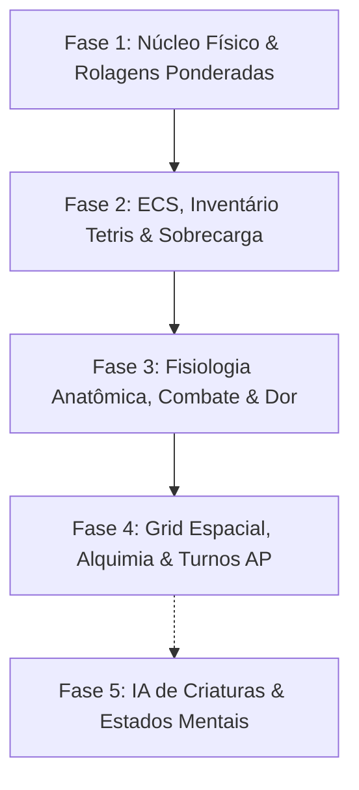

# 🌌 FROM OMINI — Roguelike Tático Hardcore & Motor de Simulação em Java Puro

[](https://adoptium.net/)
[]()
[]()
[-brightgreen.svg)]()
[-purple.svg)]()

> **"No From Omini, nada é abstrato: todo item tem massa e volume, todo golpe atinge um membro específico, toda ferida sangra e quebra ossos, e todo elemento no chão reage quimicamente em cadeia."**

---

## 📖 Visão Geral do Projeto

**From Omini** é um motor de jogo e roguelike tático por turnos desenvolvido em **Java 17 puro** com arquitetura desacoplada (Clean Architecture + Entity-Component-System), projetado para rodar com alta fidelidade tanto no desktop quanto em dispositivos móveis Android.

Inspirado na profundidade de simulação de *Cataclysm: Dark Days Ahead (CDDA)*, no combate tático e anatomia visceral de *Dwarf Fortress*, no gerenciamento de inventário espacial de *Resident Evil 4* e na jogabilidade fluida em turnos de *Shattered Pixel Dungeon*.

### 💎 Pilares de Engenharia

1. **Zero Dependências Externas:** O motor roda em Java Vanilla estrito, sem necessidade de Gradle Daemons pesados, frameworks de injeção ou bibliotecas de terceiros para suas regras de domínio.
2. **Arquitetura Orientada a Dados (Data-Driven & Modding-First):** O jogo base (`base_game`) é estruturado como um mod. Qualquer comportamento, material, membro anatômico, tipo de dano ou reação elemental é configurado via arquivos JSON em cascata (`CascadeModLoader`).
3. **Fisiologia Realista:** Sem barras de HP genéricas. Cada criatura possui membros individuais com pontos de vida próprios, suscetíveis a fraturas ósseas, hemorragias ativas e acúmulo de dor neural.
4. **Ambiente Alquímico e Reativo:** Fluidos e gases no chão interagem com o fogo, choque e impactos mecânicos, gerando vapor, explosões em área e fumaça que bloqueia a visão tática em tempo real.
5. **Determinismo e Testabilidade:** Toda a mecânica de jogo é testada por uma suíte automatizada em duas camadas (unitária e integração), garantindo zero regressões.

---

## 🗺️ Mapa de Implementação: O Que Já Foi Construído

O desenvolvimento do motor é dividido em fases incrementais e rigorosamente testadas. Até o momento, as **Fases 1, 2, 3 e 4 estão 100% implementadas, testadas e integradas na branch `main`**.



---

### 🟢 FASE 1: Núcleo do Motor, Testes Ponderados & Física de Materiais

A fundação matemática e o carregador do jogo.

- **Distribuição Triangular Contínua com Pesos:**
  - Caso de uso: `CalcularRangeTesteUseCase` e `CalcularDistribuicaoPesosUseCase`.
  - Permite testes de perícia com distribuição não uniforme onde atributos e perícias definem o ponto de equilíbrio probabilístico (formato de sino triangular).
- **Graus de Sucesso Triplo:**
  - Caso de uso: `ResolverGrauSucessoUseCase`.
  - Avaliação de margem de sucesso/falha: Sucesso Crítico (margem $\ge +50\%$), Sucesso Decisivo ($+15\%$), Sucesso Padrão, Falha Padrão, Falha Crítica ($-15\%$) e Desastre Total ($\le -50\%$).
- **Física de Matéria & Massa Procedural:**
  - Caso de uso: `CalcularMassaProceduralUseCase`.
  - Cálculo de massa real com base na densidade do material em $\text{g/cm}^3$ e no volume geométrico em $\text{cm}^3$ ($M = V \times \rho$).
- **Catálogo Oficial e Parser JSON:**
  - Repositórios concretos: `JsonMaterialRepository` e `JsonDamageTypeRepository`.
  - Catálogos de dados: `materials.json` (madeira, ferro, aço, granito, carne, osso, couro, vidro) e `damage_types.json` (cortante, perfurante, contundente, fogo, eletricidade, ácido).
- **Carregador de Mods em Cascata (`CascadeModLoader`):**
  - Sistema que carrega os catálogos primários de `base_game/data/` e sobrepõe mods da pasta `mods/` por ID sem recompilar o motor.

---

### 🟢 FASE 2: Entidades ECS, Inventário em Grade Tetris & Sobrecarga

O coração do manuseio de itens e da arquitetura de software.

- **Arquitetura Entity-Component-System (ECS):**
  - Entidade atômica (`Entity`) gerenciando componentes de dados puros (`Component`) com tags indexadas case-insensitive (`addTag`, `hasTag`).
  - Componentes essenciais: `MaterialComponent`, `ItemComponent`, `PositionComponent`, `InventoryGridComponent`.
- **Inventário em Grade Bidimensional (Estilo Tetris / Resident Evil 4):**
  - Casos de uso: `InserirItemGradeUseCase`, `RemoverItemGradeUseCase`, `RotacionarItemInventarioUseCase`.
  - Matriz espacial com suporte a itens multislot (ex: rifle ocupando $4 \times 1$ slots, mochila ocupando $3 \times 3$).
  - Rotação dinâmica de 90° ($W \times H \leftrightarrow H \times W$) com verificação de colisão nos limites da grade.
  - Alocação e desalocação geométrica precisa (`PositionedItemVO`).
- **Sistema de Sobrecarga Corporal & Capacidade de Carga:**
  - Caso de uso: `CalcularSobrecargaUseCase`.
  - Capacidade Confortável: $\text{Força} \times 5.0\text{ kg}$.
  - Capacidade Máxima: $\text{Força} \times 10.0\text{ kg}$.
  - 5 Faixas de Sobrecarga (`NivelSobrecargaEnum`):
    - **Leve ($\le 50\%$ da confortável):** $0\%$ penalidade de AP e esquiva.
    - **Confortável ($\le 100\%$ da confortável):** $0\%$ penalidade.
    - **Pesada ($\le 150\%$ da confortável):** $+15\%$ custo de AP, $-20\%$ esquiva.
    - **Crítica ($\le \text{capacidade máxima}$):** $+40\%$ custo de AP, $-50\%$ esquiva.
    - **Incapacitado ($> \text{capacidade máxima}$):** $+100\%$ custo de AP, $-100\%$ esquiva (imóvel).

---

### 🟢 FASE 3: Fisiologia Anatômica, Combate Localizado, Fraturas, Dor & Foco

Substituição da barra de vida convencional por medicina tática e dano biomecânico.

- **Anatomia Humanoide em 14 Membros Independentes (`anatomy.json`):**
  - Cabeça, Olho Esquerdo/Direito, Tronco (Vital), Braço Esquerdo/Direito, Antebraço Esquerdo/Direito, Mão Esquerda/Direita, Coxa Esquerda/Direita, Canela Esquerda/Direita e Pés.
  - Cada membro possui razão de HP sobre o HP base ($CON \times 10$), área de superfície relativa (`hit_weight`), flag de vitalidade e slot de armadura.
- **Sorteio Balístico de Membro Atingido com Cobertura & Mira por Foco:**
  - Caso de uso: `SortearMembroAtingidoUseCase`.
  - **Sorteio por peso:** Membros maiores (tronco) têm mais probabilidade natural de serem atingidos que membros pequenos (olhos/mãos).
  - **Sistema de Cobertura Física:** Se o alvo estiver atrás de mureta ou trincheira, membros inferiores (coxas, pernas, pés) são anulados da rolagem ($0\%$ de chance).
  - **Mira Cirúrgica com Foco:** O atacante pode consumir pontos de Foco para forçar o golpe em um membro crítico (ex.: tiro na cabeça).
- **Dano Localizado, Fraturas e Morte Clínica:**
  - Caso de uso: `AplicarDanoLocalizadoUseCase`.
  - Se um membro chegar a $0\text{ HP}$, sofre **Fratura Óssea Completa** e abre hemorragia proporcional ao trauma.
  - Se um membro vital (`vital == true`, como cabeça ou tronco) for destruído, a entidade sofre **Morte Imediata**.
- **Sistema Neurobiológico de Dor & Analgésicos:**
  - Componente: `PainFocusComponent`.
  - Casos de uso: `CalcularPenalidadesDorUseCase`, `TratarFerimentoUseCase`.
  - $\text{Dor Efetiva} = \max(0.0, \text{Dor Real} - \text{Nível Analgésico})$.
  - $\text{Teto Dinâmico de Foco Mental} = 100.0 - \text{Dor Efetiva}$. (Muita dor impede o personagem de mirar com precisão ou executar ações complexas).
- **Procedimentos de Primeiros Socorros:**
  - **Curativo / Bandagem:** Estanca a perda de sangue por turno daquele membro ferido.
  - **Tala Ortopédica:** Imobiliza a fratura, reduzindo drasticamente a dor gerada e permitindo locomoção com menor esforço.
  - **Analgésicos:** Entram na corrente sanguínea reduzindo a dor percebida temporariamente.
- **Ciclo Metabólico de Turno Fisiológico:**
  - Caso de uso: `ProcessarCicloTurnoFisiologicoUseCase`.
  - Hemorragias abertas sangram a cada turno consumindo HP total.
  - Analgésicos decaem gradativamente até passarem o efeito.
  - Foco mental regenera até o limite do teto imposto pela dor.
  - Fome, sede e estamina são consumidos a cada ciclo (`SurvivalComponent`).

---

### 🟢 FASE 4: Grid Espacial, Alquimia Elemental & Motor de Turnos (AP)

O mundo físico bidimensional, reações químicas e iniciativa tática.

- **Grade Matricial 2D & Terrenos Reativos:**
  - Modelos: `TileMap`, `TileTypeEnum` (`CHAO_PEDRA`, `PAREDE_GRANITO`, `PORTA`, `AGUA_RASA`, `GRAMA`).
  - Custos diferenciados de deslocamento e controle de passabilidade e transparência.
- **Linha de Visão (Field of View / FOV) por Raycasting:**
  - Caso de uso: `CalcularLinhaDeVisaoUseCase`.
  - Algoritmo de traçado discreto de raios de **Bresenham**.
  - Paredes sólidas e nuvens densas de fumaça bloqueiam dinamicamente o raio de visão.
- **Pathfinding A* (A-Star) com Custos Variáveis:**
  - Caso de uso: `NavegarPathfindingAStarUseCase`.
  - Suporte a 8 direções (ortogonal + diagonal com fator $\sqrt{2}$).
  - Fila de prioridade avaliando custo acumulado $g(n)$ e heurística euclidiana $h(n)$.
  - **Prevenção estrita de corte de quinas:** impede que entidades atravessem a diagonal entre duas paredes adjacentes.
- **Alquimia Elemental & Reações Ambientais:**
  - Catálogo: `environmental_reactions.json` carregado por `JsonEnvironmentalReactionRepository`.
  - Componente: `SurfaceFieldComponent`.
  - Caso de uso: `ProcessarReacaoAmbientalUseCase`.
  - **Reações implementadas e testadas:**
    1. **Fogo + Água:** Extinção mútua gerando uma espessa **Nuvem de Fumaça/Vapor** (`field_smoke` com tag `bloqueia_visao`) por 6 turnos.
    2. **Fogo + Gás Inflamável:** Detonação violenta imediata em área com poder destrutivo de 60.
    3. **Choque Elétrico + Água:** Eletrificação de toda a poça, aplicando 25 de dano de choque por turno a quem pisar nela.
- **Motor de Turnos Baseado em Energia & Pontos de Ação (AP):**
  - Componente: `TurnEnergyComponent`.
  - Modelos e UseCases: `TipoAcaoEnum`, `MotorTurnosAPUseCase`, `CalcularCustoAcaoAPUseCase`.
  - **Custos Base:** Mover (100 AP), Atacar (120 AP), Usar Item (80 AP), Recarregar (150 AP), Esperar (100 AP).
  - **Iniciativa:** Entidades acumulam energia a cada tick global proporcional à sua Destreza ($\text{Velocidade} = 100 + DES \times 2$). Atingindo o limiar de 100 AP, a entidade pode agir.
  - **Penalidades Fisiológicas no custo de AP:**
    - Carga Pesada: $+15\%$ AP; Incapacitado por peso: $+100\%$ AP.
    - **Perna Fraturada:** Dobra ($+100\%$) o custo de locomoção (andar custa 200 AP em vez de 100 AP).
    - **Perna Fraturada com Tala:** Reduz a penalidade para apenas $+40\%$ (custo 140 AP).
    - Dor aguda ($> 20$): Atraso neural de até $+25\%$ no tempo de reação.
- **Gerador Procedural de Mapas Baseado em Dados:**
  - Casos de uso: `GerarMapaProceduralUseCase`, `ParametrosGeracaoMapaDTO`, `ResultadoGeracaoMapaVO`.
  - Geração determinística orientada por semente (`seed`): salas retangulares não sobrepostas escavadas na rocha e conectadas por corredores ortogonais em "L". Conectividade total comprovada por A*.

---

## 🏗️ Arquitetura do Código-Fonte

O projeto segue rigorosamente os preceitos da **Clean Architecture** (Arquitetura Limpa):

```text
Desenvolvimento/
├── base_game/                         # Pacote de dados Vanilla (JSONs oficiais)
│   └── data/
│       ├── anatomy.json               # Definição dos membros anatômicos
│       ├── damage_types.json          # Tipos de dano e multiplicadores
│       ├── environmental_reactions.json # Regras de alquimia e reações
│       ├── materials.json             # Materiais e propriedades físicas
│       └── items/                     # Catálogo de equipamentos e armas
│
├── docs/                              # Documentação viva e auditorias
│   └── historico-ciclos/              # Logs de cada fase concluída (Ciclos 1 a 4)
│
└── src/
    ├── main/java/com/omini/engine/
    │   ├── data/                      # Infraestrutura de persistência e parsers
    │   │   ├── json/                  # SimpleJsonParser (Parser JSON autônomo)
    │   │   ├── loader/                # CascadeModLoader (Injeção de mods)
    │   │   └── repositories/          # Implementações concretas de repositórios
    │   │
    │   └── domain/                    # Regras de Negócio Puras (Zero Frameworks)
    │       ├── dtos/                  # Value Objects imutáveis (Coordenadas, Partes, Estados)
    │       ├── ecs/                   # Núcleo ECS (Entity, Component)
    │       │   └── components/        # Dados puros (Anatomy, Inventory, Stats, Surface, Energy...)
    │       ├── models/                # Modelos de domínio imutáveis e Enums
    │       ├── repositories/          # Interfaces e contratos
    │       └── usecases/              # 1 caso de uso = 1 ação única de domínio
    │
    └── test/java/com/omini/engine/
        ├── unit/                      # Camada 1: Testes unitários puros por usecase
        └── integration/               # Camada 2: Testes integrando loader, mapa, ECS e combate
```

---

## 🧪 Suíte de Testes Automatizados (100% de Aprovação)

O motor conta com um pipeline de validação automatizado e determinístico executado via assertions nativas do Java (`-ea`), sem necessidade de JUnit externo.

| Camada | Classe de Teste | Fase | Responsabilidade Validada | Status |
| :--- | :--- | :---: | :--- | :---: |
| **Unit** | `CalcularRangeTesteUseCaseTest` | F1 | Ranges probabilísticos triangulares | ✅ **100%** |
| **Unit** | `CalcularDistribuicaoPesosUseCaseTest` | F1 | Normalização de pesos estatísticos | ✅ **100%** |
| **Unit** | `ResolverGrauSucessoUseCaseTest` | F1 | Sucessos e falhas críticas por margem | ✅ **100%** |
| **Unit** | `CalcularMassaProceduralUseCaseTest` | F1 | Volume $\times$ densidade de materiais | ✅ **100%** |
| **Unit** | `EntityEcsTest` | F2 | Gestão de componentes e tags no ECS | ✅ **100%** |
| **Unit** | `InventarioGradeUseCaseTest` | F2 | Grade Tetris, rotação 90° e colisões | ✅ **100%** |
| **Unit** | `CalcularSobrecargaUseCaseTest` | F2 | 5 níveis de sobrecarga por força | ✅ **100%** |
| **Unit** | `SortearMembroAtingidoUseCaseTest` | F3 | Sorteio ponderado, cobertura e mira | ✅ **100%** |
| **Unit** | `AplicarDanoLocalizadoUseCaseTest` | F3 | Dano em membros, fraturas e letalidade | ✅ **100%** |
| **Unit** | `DorEFocoFisiologiaTest` | F3 | Teto de foco por dor, curativos e talas | ✅ **100%** |
| **Unit** | `GridEPathfindingTest` | F4 | A*, distâncias e FOV por Bresenham | ✅ **100%** |
| **Unit** | `AlquimiaElementalTest` | F4 | Extinção com fumaça, detonação e choque | ✅ **100%** |
| **Unit** | `MotorTurnosAPTest` | F4 | Ticks de relógio, iniciativa e AP penalizado | ✅ **100%** |
| **Unit** | `GeradorMapaProceduralTest` | F4 | Geração determinística e conectividade | ✅ **100%** |
| **Integration** | `NucleoMotorIntegrationTest` | F1 | Mod loader cascata + física de materiais | ✅ **100%** |
| **Integration** | `InventarioSobrecargaIntegrationTest`| F2 | ECS + itens reais + sobrecarga no inventário | ✅ **100%** |
| **Integration** | `FisiologiaAnatomiaIntegrationTest` | F3 | Catálogo humano real, trauma, sangramento e socorro | ✅ **100%** |
| **Integration** | `MapaTurnosAlquimiaIntegrationTest` | F4 | Masmorra procedural + A* + reação de fumaça bloqueando FOV + fratura | ✅ **100%** |

---

## 🚀 Como Compilar e Rodar os Testes

Como o projeto usa **Java puro** e nenhuma dependência externa, você só precisa do JDK 17+ instalado no seu sistema operacional.

### No Windows (PowerShell)

Para compilar todo o código e rodar a suíte completa de testes das Fases 1 a 4:

```powershell
# 1. Obter a lista de fontes Java
$sources = Get-ChildItem -Path "Desenvolvimento/src" -Recurse -Filter "*.java" | ForEach-Object { $_.FullName }
[System.IO.File]::WriteAllLines("sources.txt", $sources, [System.Text.UTF8Encoding]::new($false))

# 2. Compilar
if (-not (Test-Path "bin")) { New-Item -ItemType Directory -Path "bin" }
javac -d bin -encoding UTF-8 @sources.txt

# 3. Executar o Teste de Integração Geral da Fase 4
java -ea -cp bin com.omini.engine.integration.MapaTurnosAlquimiaIntegrationTest
```

Ou execute diretamente o script de automação:
```powershell
powershell -ExecutionPolicy Bypass -File "scratch/build_test.ps1"
```

### No Linux / macOS (Bash)

```bash
# 1. Compilar todas as classes
find Desenvolvimento/src -name "*.java" > sources.txt
mkdir -p bin
javac -d bin -encoding UTF-8 @sources.txt

# 2. Executar suíte integrada
java -ea -cp bin com.omini.engine.integration.MapaTurnosAlquimiaIntegrationTest
```

---

## 🔮 Próximas Fases (Roadmap)

- [ ] **Fase 5: Inteligência Artificial de Criaturas & Estados Mentais:** Máquinas de estado finito (FSM), detecção de ameaças pelo FOV, audição de ruídos e instinto de sobrevivência/fuga.
- [ ] **Fase 6: Termodinâmica Corporal & Transmissão de Calor:** Temperatura ambiente, hipotermia, hipertermia, isolamento térmico de roupas e combustão de tecidos.
- [ ] **Fase 7: Balística Avançada & Penetração de Blindagem:** Velocidade de projéteis, dispersão, ângulo de impacto, ricochete e proteção multicamada de armaduras.
- [ ] **Fase 8: Interface Touch-First para Android & Renderização Visual:** Camada de apresentação gráfica mobile com controles táteis responsivos e HUD dinâmico.

---

## 👤 Autor & Licença

- **Autor:** João (TrevorSalazar66)
- **Repositório GitHub:** [https://github.com/TrevorSalazar66/FromOmini_game.git](https://github.com/TrevorSalazar66/FromOmini_game.git)
- **Licença:** MIT (consulte o arquivo LICENSE para detalhes).
